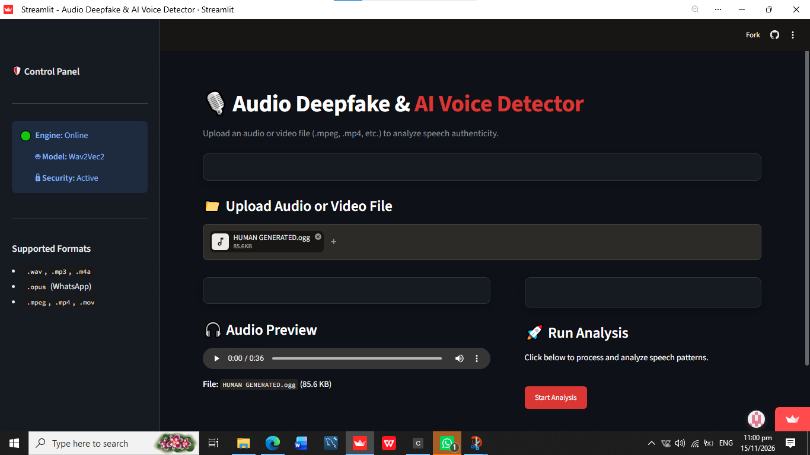
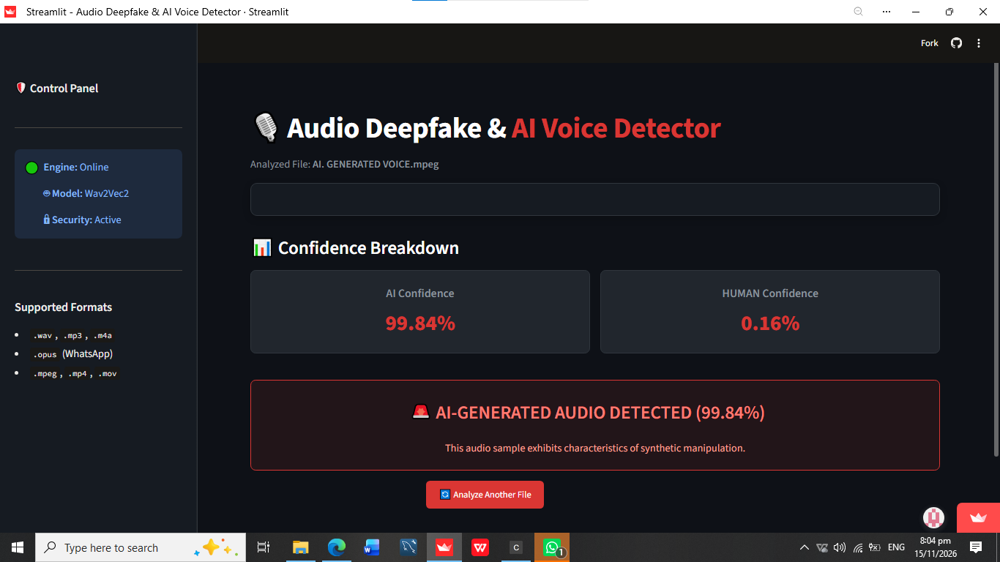
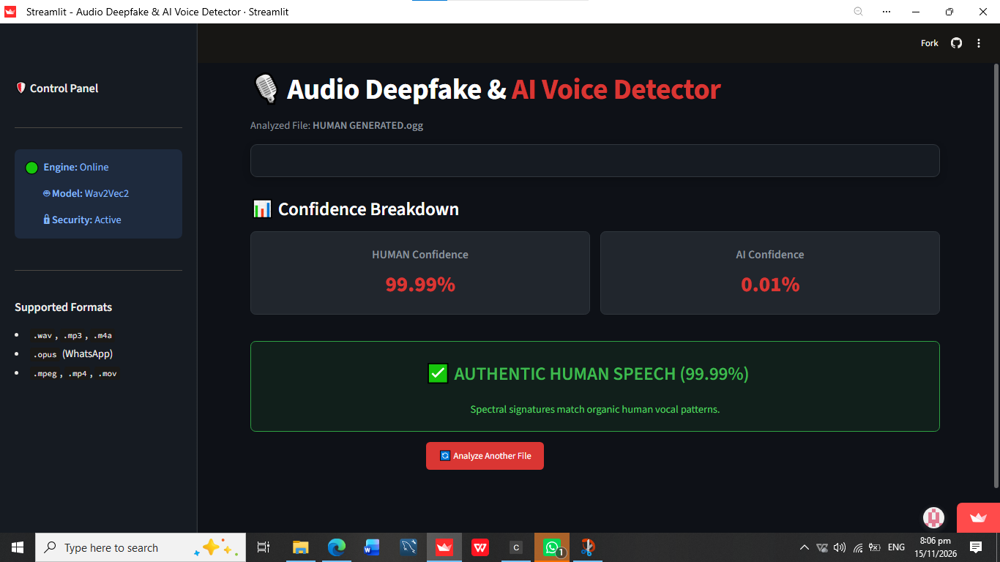

# 🎙️ Audio Deepfake & AI Voice Detector

An enterprise-grade, university-branded web application built with Python and Streamlit to detect synthetic AI-generated audio and video speech manipulation.

## 🚀 Features
- **Multi-Format Support:** Accepts `.wav`, `.mp3`, `.m4a`, `.opus`, `.ogg`, `.flac`, `.mpeg`, `.mp4`, and `.mov` files.
- **Automated Audio Extraction:** Utilizes backend `ffmpeg` processing to seamlessly extract audio tracks from video files.
- **Deep Learning Model:** Powered by Hugging Face transformers (`MelodyMachine/Deepfake-audio-detection`).
- **Enterprise UI:** Designed with a clean dark theme and university-branded red accents for high readability.

## 🛠️ Tech Stack
- **Frontend & UI:** Streamlit
- **AI / ML Core:** PyTorch, Hugging Face Transformers (`Wav2Vec2`)
- **Audio Processing:** Librosa, SoundFile, FFmpeg
- **Deployment:** Streamlit Community Cloud & GitHub

## 🏃‍♂️ Local Execution
1. Clone the repository:
   ```bash
   git clone [https://github.com/MEHMAAASIM-TECH/audio-deepfake-detector.git](https://github.com/MEHMAAASIM-TECH/audio-deepfake-detector.git)
   cd audio-deepfake-detector

## 🖼️ Application Interface & Workflow

### 1. File Upload & Video Preview Screen


### 2. AI-Generated Voice Detection Result


### 3. Authentic Human Speech Detection Result

